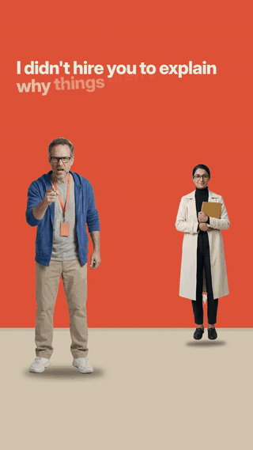

# Human-centric-animation

Two Claude skills that work as a pipeline for making stop-motion style reels, ads and scroll pages starring original photo-real cutout characters.

> **Built for solopreneurs.** We'll keep publishing new Claude skills here so that solo founders can promote their products with striking animations: no agency, no animator, no motion-design skills. Star or watch the repo to get each new skill as it drops.

<p align="center">
  
</p>

<p align="center"><b>▶ <a href="media/selltheclick-founder-rant.mp4">Watch the full reel with sound (41s MP4)</a></b><br>
<sub>Made with these two skills: AI-generated characters, stop-motion pose swaps, a voiceover with timed captions, and a soft-sell end card. Contains strong language.</sub></p>

| Skill | What it does |
|---|---|
| [`collage-character-set`](skills/collage-character-set/SKILL.md) | Designs an original character (or cast), generates a consistent pose set, cuts the poses out and normalizes them into `characters/<name>/` |
| [`collage-reel-animator`](skills/collage-reel-animator/SKILL.md) | Turns those characters plus a script into a 9:16 reel (MP4) or a scroll-driven web page: beat sheet, pose swaps, word stamps, voiceover, render |

## Pipeline
```
script ─► character bible ─► master image ─► pose set (same chat / char ref)
       ─► cutout.py (shared crop, watermark-safe) ─► characters/<name>/*.webp
       ─► beat sheet + scene.html (seek(t)) ─► voiceover ─► render.js ─► reel.mp4
```

## Install
Upload each folder under `skills/` as a skill in Claude (Settings → Capabilities → Skills), or copy it into `~/.claude/skills/` for Claude Code.

Script requirements:
- `pip install rembg onnxruntime pillow`
- `npm i playwright-core`, plus Chrome or Chromium
- ffmpeg
- optional: `pip install piper-tts` for offline voice

## Example
[`examples/selltheclick-founder-rant`](examples/selltheclick-founder-rant): a 41s reel in which a furious SaaS founder rants at his ad agency, ending on a soft sell for tryselltheclick.com. It includes the scene file and the character prompt pack.

## Rules baked in
- Original characters only: no real people, celebrities, or existing brand or film characters.
- Every pose must be the same person in the same outfit. Regenerate any pose that drifts.

## What's next
This is a growing library, and more animation skills for solopreneurs are on the way:
- **Animated explainer maps**: metro-map and flow-style infographics with looping motion for LinkedIn lead magnets
- **More character formats**: customer personas, product mascots and multi-character skits
- **Ad-ready variants**: bleeped cuts, 1:1 and 16:9 exports, and hook A/B versions from one scene

Have a format you want? Open an issue.

